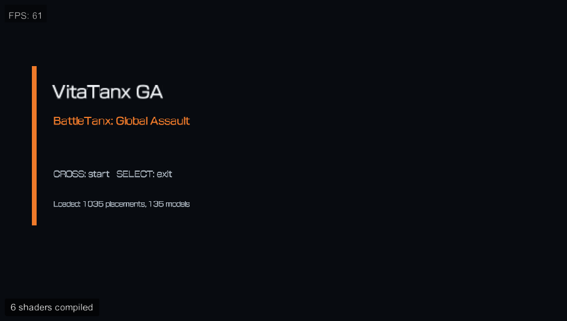
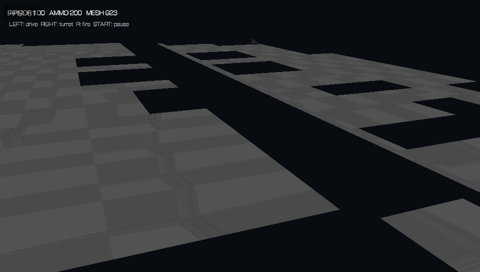

# VitaTanxGA

VitaTanxGA is an in-progress PlayStation Vita port of **BattleTanx: Global
Assault**. It uses the recovered N64 source from
[BattleTanx-Global-Assault](https://github.com/TheGh0stShip/BattleTanx-Global-Assault)
as its reference foundation while keeping Vita portability work isolated from
the matching-decompilation project.

## Current status

The repository currently produces an installable PS Vita VPK that:

- targets 32-bit ARMv7-A/Thumb with the VitaSDK hard-float ABI;
- runs platform-neutral game state at a fixed 30 Hz simulation rate;
- maps Vita buttons and both analog sticks into a portable input structure;
- renders perspective world geometry with the original vertex UVs, decoded
  N64 textures, recovered tile origins and coordinate shifts,
  wrap/mirror/clamp sampling, material colors, separate opaque/alpha depth
  handling, placements, depth testing, yaw transforms, and recovered rotated
  mode-1/mode-2 blocking volumes for tank collision;
- provides title, gameplay, and pause states with controllable tank movement,
  turret aiming, cooldown-limited held-trigger firing, ammunition, projectiles
  rendered with the recovered
  transparent N64 intensity sprite, retail pickup-to-weapon inventory mapping,
  secondary fire, weapon cycling, shields, and a following camera;
- decodes the complete 76-wave retail libmus SFX bank from N64 ADPCM/raw16
  into a compact indexed PCM bank and routes recovered weapon effect IDs
  through a dedicated Vita audio thread;
- resolves and renders the player's original tank asset through the recovered
  shared model-ID table, including body, turret, treads, and detail layers;
- maps all 19 campaign records through the recovered retail asset dispatcher,
  loading each mission's extracted geometry and actor/spawn world pair;
- provides campaign mission selection and completion progression persisted at
  `ux0:data/VitaTanxGA/save.bin`, while preserving explicit serialized widths;
- applies each retail campaign setup record's one-player slot reorder and
  configured tank kinds/teams instead of activating every placement marker;
- renders those enemies with their recovered per-kind vehicle definitions,
  retail campaign team colors, independently tracking turret parts, steering,
  pursuit, firing along the turret heading, projectile ownership, hit detection,
  damage, and enemy plus recovered mission-object completion;
- resolves and renders all 41 first-mission pickup placements through the
  recovered pickup-kind/model table and original textured common-world models,
  with retail health, ammunition, weapon inventory, tank-buck, and radar effects;
- derives navigation heights from the placed retail level geometry;
- loads and validates extracted big-endian world component tables;
- instantiates recovered structures, turrets, foliage, mission props, selection
  actors, and actor structures as live objects with retail model bounds,
  projectile/blast damage, destruction, and restart state; nonzero recovered
  mission-type markers participate in completion without treating scenery as
  an objective;
- packages the campaign worlds, shared world pools, projectile
  sprites, the decoded SFX bank, mission scripts, and original campaign
  text/configuration tables;
- presents the recovered San Francisco Airport location, objective, and full
  mission briefing between the opening narrative and deployment;
- parses the first retail campaign script's 41 streams and 23,483
  variable-width commands, and executes its recovered seven-card opening
  narrative with original 30 Hz waits on the portable runtime boundary;
- validates the executable and code-bearing libraries for ABI consistency.

The complete-game path also reproducibly translates the same 1,879-function
retail catalogue used by the playable PC port. All 35 generated C units compile
as a 1.7 MiB static library with VitaSDK's ARMv7-A hard-float compiler.
Generated translation sources and ROM-derived binary data remain local and
ignored. An ARM fallback implements the R4300's signed and unsigned 64x64-bit
multiply results without assuming AArch64 or compiler `__int128` support.

This is an **in-progress runtime port**, not yet the complete game. The full
translated game still needs Vita-native N64 scheduling and display-list
services before it can replace the current portable gameplay executable.
Remaining sound effects, music, and frontend services are also still being
ported from the recovered implementation.

## Windows Vita3K captures

These captures are from the repository VPK running in `D:\Vita3K`. They are
emulator evidence, not a physical-hardware validation claim.





## Requirements

- A legally obtained USA Rev 0 BattleTanx: Global Assault ROM
- [VitaSDK](https://vitasdk.org/), including Vita2D
- CMake and Python 3

The supported ROM is an 8 MiB big-endian `.z64` dump with SHA-1:

```text
805248fb0a0ee694cad8d7dc927b631d860dd8cf
```

ROMs, extracted resources, generated binaries, and hardware evidence must not
be committed to this repository.

## Build

Export VitaSDK and place the verified ROM at `baseroms/us/baserom.z64`:

```sh
export VITASDK=/path/to/vitasdk
export PATH="$VITASDK/bin:$PATH"
make vita-check
```

To capture the current VPK with the Windows Vita3K installation:

```powershell
tools\capture_vita3k_windows.ps1 `
  -VpkPath port\vita\build\vitatanxga.vpk `
  -OutputDirectory docs\screenshots
```

`make vita-check` performs the complete local pipeline:

1. verifies the ROM;
2. extracts decoded game resources into the ignored
   `assets/extracted/us/vita` directory;
3. validates the extracted first-level world and every referenced geometry,
   state, texture, spawn, pickup, and campaign-text record through the portable
   C loaders;
4. cross-compiles the Vita executable;
5. packages the extracted resources into the VPK;
6. runs the host-side portable-runtime tests; and
7. verifies ELF32 ARMv7-A and hard-float attributes.

The resulting package is:

```text
port/vita/build/vitatanxga.vpk
```

See [docs/VITA_PORT.md](docs/VITA_PORT.md) for architecture and packaging
details.

## Architecture rules

- Original N64 code uses big-endian MIPS III with a 32-bit o32 ABI.
- PS Vita uses little-endian ARMv7-A with an ILP32 ABI. It is not AArch64.
- ROM addresses and serialized pointers remain explicit 32-bit tokens.
- Big-endian resource data must be decoded explicitly rather than cast through
  native Vita structures.
- Vita-specific APIs remain under `port/vita`; matching N64 source remains a
  reference and evidence boundary.
- Emulator or host success does not prove physical Vita correctness.

No package should be described as hardware-validated until it has completed a
supervised test on a physical PS Vita.

## License

Project-authored code and imported GPL research are licensed under GPL-3.0;
see [COPYING](COPYING). BattleTanx: Global Assault and its game data remain the
property of their respective rights holders.
